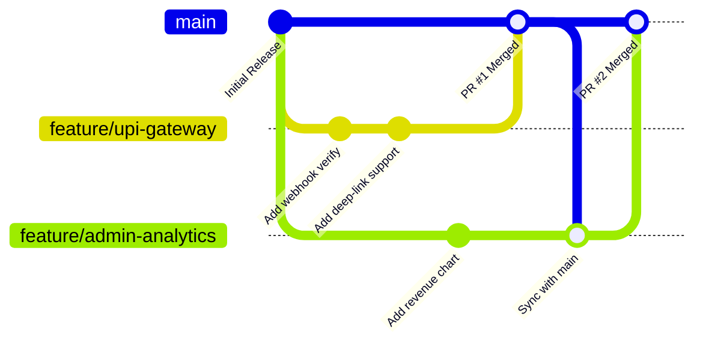

# 🤝 Smart Kirana — Startup Partner Collaboration & Deployment Guide

This guide describes how two startup partners (Developer A and Developer B) collaborate simultaneously on **Smart Kirana** using GitHub, branch workflows, pull requests, conflict resolution, and free-tier production deployment.

---

## 1. Initial GitHub Setup

### Developer A (Repository Creator):
1. Initialize the git repo locally (already completed in workspace):
   ```bash
   git add .
   git commit -m "feat: initial commit of Smart Kirana application"
   ```
2. Create a new repository on [GitHub](https://github.com/new) named `smart-kirana`.
3. Set the remote and push the `main` branch:
   ```bash
   git branch -M main
   git remote add origin https://github.com/<YOUR_GITHUB_USERNAME>/smart-kirana.git
   git push -u origin main
   ```
4. **Invite Partner B**:
   - Go to your repository on GitHub → **Settings** → **Collaborators** → **Add people**.
   - Enter Developer B's GitHub username or email and grant **Write / Admin** access.

---

### Developer B (Partner Onboarding):
1. Accept the GitHub invitation link received via email or in the GitHub notification bell.
2. Clone the repository on Developer B's machine:
   ```bash
   git clone https://github.com/<YOUR_GITHUB_USERNAME>/smart-kirana.git
   cd smart-kirana
   ```
3. Install dependencies:
   ```bash
   npm install
   ```
4. Copy the environment variables:
   ```bash
   cp .env.example .env
   ```
5. Start local development server:
   ```bash
   npm run dev
   ```

---

## 2. Team Branching Strategy

To avoid stepping on each other's toes, **never push directly to `main`**.



### Branch Naming Conventions:
- Feature: `feature/product-reviews`, `feature/rider-tracking`
- Bugfix: `fix/checkout-pincode-validation`, `fix/cart-stepper`
- Improvement: `perf/image-loading`, `ui/hero-redesign`

### Daily Developer Workflow:

```bash
# 1. Always start your workday by updating main
git checkout main
git pull origin main

# 2. Create a new feature branch
git checkout -b feature/your-feature-name

# 3. Work and test your changes
npm run dev
npm run build   # ensures zero syntax or build errors

# 4. Stage and commit with clean messages
git add .
git commit -m "feat: add express delivery timer to order tracking"

# 5. Push your feature branch to GitHub
git push -u origin feature/your-feature-name
```

---

## 3. Pull Requests & Code Review Checklist

1. On GitHub, navigate to **Pull requests** → **New pull request**.
2. Select `base: main` ← `compare: feature/your-feature-name`.
3. Add your partner as a **Reviewer**.
4. Both partners follow the review checklist:
   - [ ] Does `npm run build` pass without warnings or errors?
   - [ ] Is mobile responsiveness intact across phone and desktop viewports?
   - [ ] Are prices and stock limits properly checked?
   - [ ] Are secret credentials excluded from commits?
5. Partner clicks **Approve** and selects **Squash and merge** (or Rebase and merge).

---

## 4. Resolving Merge Conflicts

If both partners edit the same file simultaneously:

1. Fetch and merge latest `main` into your local feature branch:
   ```bash
   git checkout feature/your-feature-name
   git pull origin main
   ```
2. Git will mark conflict markers in the file:
   ```javascript
   <<<<<<< HEAD (Your local changes)
   const deliveryFee = 25;
   =======
   const deliveryFee = 20;
   >>>>>>> main (Partner's changes)
   ```
3. Open the file in VS Code, choose **Accept Incoming Change**, **Accept Current Change**, or manually blend both.
4. Stage the resolved files and finish the merge:
   ```bash
   git add .
   git commit -m "fix: resolve merge conflicts between main and feature branch"
   git push origin feature/your-feature-name
   ```

---

## 5. Free-Tier Production Deployment

### Option A: Vercel (Recommended — 2 Minute Zero-Config Setup)
1. Go to [Vercel.com](https://vercel.com) and sign in with your GitHub account.
2. Click **Add New** → **Project**.
3. Import your `smart-kirana` repository.
4. Build Settings (auto-detected):
   - **Framework Preset**: Vite
   - **Build Command**: `npm run build`
   - **Output Directory**: `dist`
5. Under **Environment Variables**, add any production variables (e.g. `VITE_SUPABASE_URL`, `VITE_SUPABASE_ANON_KEY`).
6. Click **Deploy**. Vercel gives you an instant HTTPS live link (e.g. `https://smart-kirana.vercel.app`) with automatic redeployment on every commit pushed to `main`!

### Option B: Netlify
1. Go to [Netlify.com](https://netlify.com) → **Add new site** → **Import an existing project**.
2. Connect to GitHub and select `smart-kirana`.
3. Set Publish directory to `dist` and build command to `npm run build`.
4. Add a `_redirects` file in `public/` containing:
   ```
   /*    /index.html   200
   ```
5. Click **Deploy Site**.

---

## 6. Live Supabase Backend Connection (Free Tier)
1. Sign up at [Supabase.com](https://supabase.com) (free tier includes 500MB DB, auth, and edge functions).
2. Create a new project named `smart-kirana-db`.
3. Open the **SQL Editor** in the Supabase dashboard.
4. Copy the entire contents of [`supabase_schema.sql`](file:///c:/Users/Manoj%20kumar/OneDrive/Desktop/New%20folder/supabase_schema.sql) and paste it into the editor, then click **Run**.
5. Go to **Project Settings** → **API**:
   - Copy **Project URL**
   - Copy **anon public API key**
6. Put them in your `.env` file and in your Vercel/Netlify Environment Variables:
   ```env
   VITE_SUPABASE_URL=https://your-ref.supabase.co
   VITE_SUPABASE_ANON_KEY=eyJh...
   ```
7. Both partners can now read and write to the synchronized cloud database!
